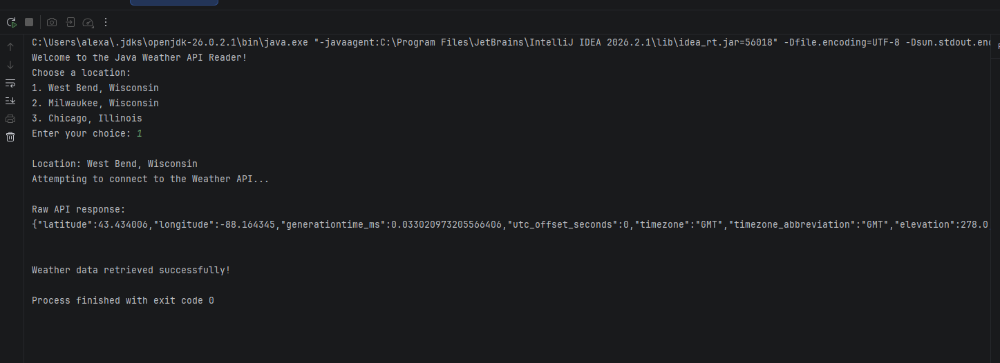
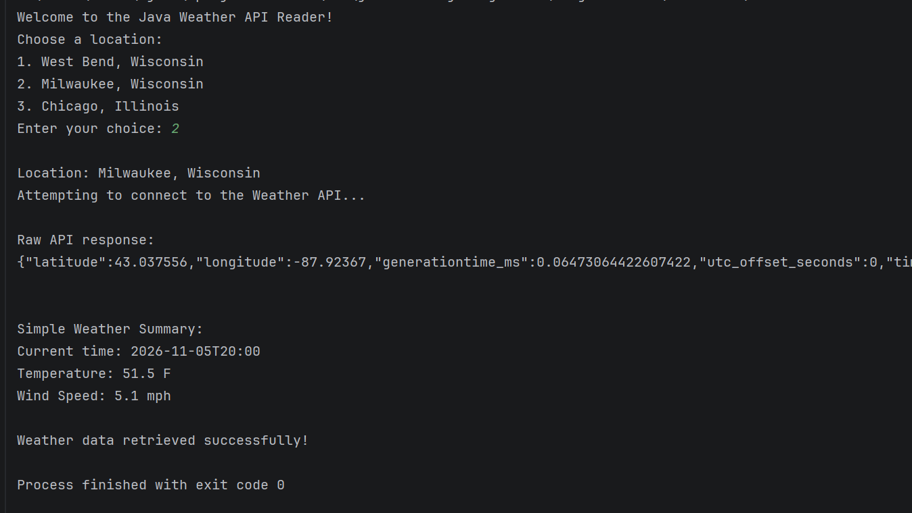

# Weather Data API Reader

## Project Description

This Java program connects to the Open-Meteo weather API and retrieves current weather information for one of 3 locations, based on what the user selects (West Bend, Milwaukee, or Chicago). The program displays the raw API response and also creates a simpler weather summary showing the current time, temperature, and wind speed.

## How to Run

1. Open the project in IntelliJ.
2. Run `WeatherAPI.java`.
3. Choose one location from the menu by entering the corresponding number.
4. View the raw API response and weather summary in the console.

NOTE: An internet connection is required for the program to retrieve current weather data.

## API Used

This program uses the Open-Meteo Forecast API:

`https://api.open-meteo.com/v1/forecast`

The program sends location coordinates to the API and retrieves current weather information.

## Screenshots

### Raw API Output

### Weather Summary Output
